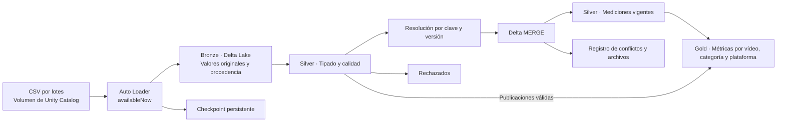
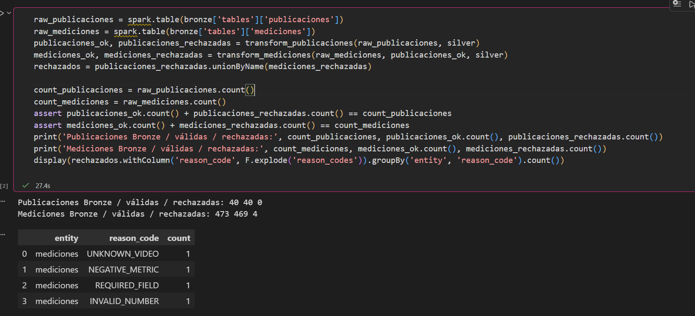
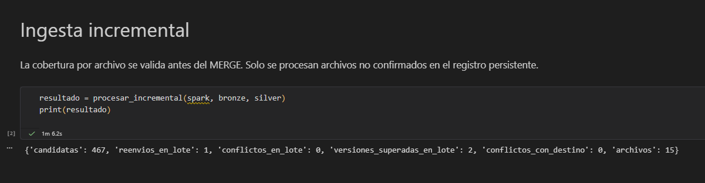
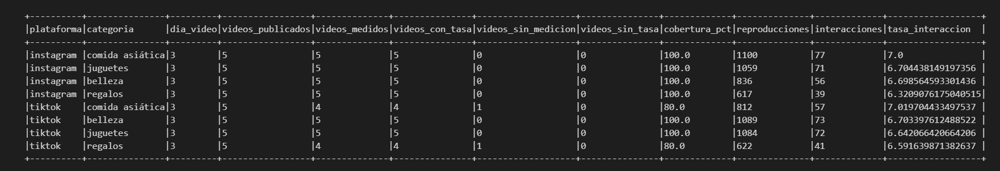

# LensData · análisis del rendimiento de vídeos

  

LensData parte de publicaciones de una tienda ficticia en TikTok e Instagram. Después de varios meses trabajando en la creación de contenido para una tienda, me surgió una pregunta: ¿qué tipo de contenido funciona mejor en cada red social?

Para comparar las categorías en las mismas condiciones, analizo las interacciones por cada 100 reproducciones al tercer día de vida de cada vídeo. El pipeline carga los datos en Bronze, los limpia y consolida en Silver mediante Delta MERGE y calcula las métricas de negocio en Gold.

El proyecto utiliza una muestra sintética de 40 publicaciones y 12 días de mediciones.

## Arquitectura

Los archivos de mediciones se conservan en `recepcion/mediciones/lote_XX/`, `lote_reenvio/` y `lote_correccion/`. Bronze almacena los campos como cadenas y registra `_metadata.file_path` en `_source_file`. Silver conserva los rechazos con su motivo y procedencia.

## Resultados comprobados

| Comprobación | Resultado |
| --- | --- |
| Archivos recibidos | 15 CSV, incluidos el vídeo desconocido, el reenvío y la corrección |
| Filas en Bronze | 473 |
| Repetición sin archivos nuevos | 471 → 471 filas |
| Publicaciones Silver | 40 válidas, 0 rechazadas |
| Mediciones Silver intermedias | 469 válidas, 4 rechazadas |
| Consolidación Silver | 467 candidatas, 15 archivos procesados, 1 reenvío idéntico, 0 conflictos reales |
| Pruebas de MERGE | 7 escenarios de integración ejecutados |
| Gold | 467 mediciones por vídeo, 8 combinaciones de categoría y plataforma, 2 plataformas |
| Cobertura al tercer día | 38 de 40 publicaciones |

Los resultados proceden de las salidas guardadas de los notebooks y las capturas de ejecución. La corrección v2 de `tiktok/V000/2026-11-01` quedó seleccionada frente al original y su reenvío v1. Las pruebas de integración comprobaron inserción, corrección, reenvíos, versiones antiguas, conflictos e idempotencia sobre tablas Delta de prueba.

## Análisis de interacción

Las tablas Gold permiten consultar la evolución de cada vídeo y comparar categorías y plataformas al tercer día, sin sumar métricas acumuladas de fechas distintas.

| Plataforma | Vídeos medidos | Reproducciones | Interacciones | Tasa de interacción |
| --- | ---: | ---: | ---: | ---: |
| Instagram | 20/20 | 3612 | 243 | 6,73 % |
| TikTok | 18/20 | 3607 | 243 | 6,74 % |

En esta muestra sintética, comida asiática obtiene la mayor tasa de interacción en ambas plataformas (7,00 % en Instagram y 7,02 % en TikTok). En TikTok se midieron cuatro de los cinco vídeos de esa categoría al tercer día, por lo que también hay que considerar la cobertura.

## Tecnologías

| Herramienta | Uso en el proyecto |
| --- | --- |
| Databricks y Unity Catalog | Volumen de recepción y tablas Bronze |
| Databricks Connect y VS Code | Desarrollo y ejecución remota de notebooks |
| PySpark y Auto Loader | Lectura recursiva e ingesta incremental de CSV |
| Delta Lake | Almacenamiento de Bronze, Silver y Gold |
| Window Functions | Selección de la versión válida más reciente por clave |
| Delta MERGE | Inserciones y actualizaciones condicionadas por versión |

## Archivos del trabajo realizado

| Ruta | Contenido |
| --- | --- |
| [`config/bronze.json`](config/bronze.json) | Rutas, tablas, checkpoints y esquemas de entrada |
| [`data/sample/`](data/sample/) | Publicaciones y lotes CSV de prueba |
| [`01_ingestar_publicaciones.ipynb`](notebooks/bronze/01_ingestar_publicaciones.ipynb) | Carga de publicaciones en Bronze |
| [`02_ingestar_mediciones.ipynb`](notebooks/bronze/02_ingestar_mediciones.ipynb) | Ingesta incremental de mediciones |
| [`01_transformar_silver.ipynb`](notebooks/silver/01_transformar_silver.ipynb) | Tipado, reglas de calidad y rechazos |
| [`02_merge_mediciones.ipynb`](notebooks/silver/02_merge_mediciones.ipynb) | Consolidación incremental y control de archivos |
| [`01_generar_gold.ipynb`](notebooks/gold/01_generar_gold.ipynb) | Métricas por vídeo, categoría y plataforma |
| [`tests/`](tests/) | Validaciones de calidad, versiones, MERGE y reconciliación Gold |
| [`test_versiones.ipynb`](tests/test_versiones.ipynb) | Pruebas de reenvío, corrección y conflicto |
| [`scripts/generar_datos.py`](scripts/generar_datos.py) | Generación reproducible de la muestra |
| [`desarrollo.md`](desarrollo.md) | Desarrollo y evidencias de las ejecuciones |

## Ejecución y pruebas

Ejecutar los notebooks de Bronze en orden, seguidos de `notebooks/silver/01_transformar_silver.ipynb` y `notebooks/silver/02_merge_mediciones.ipynb`. Por último, ejecutar `notebooks/gold/01_generar_gold.ipynb`. Los notebooks de `tests/` contienen comprobaciones manuales con Spark y se ejecutan por separado.

Consulta el [contrato de calidad](docs/calidad_datos.md), el [diseño técnico](docs/arquitectura.md) y la [propuesta](docs/propuesta.md).
