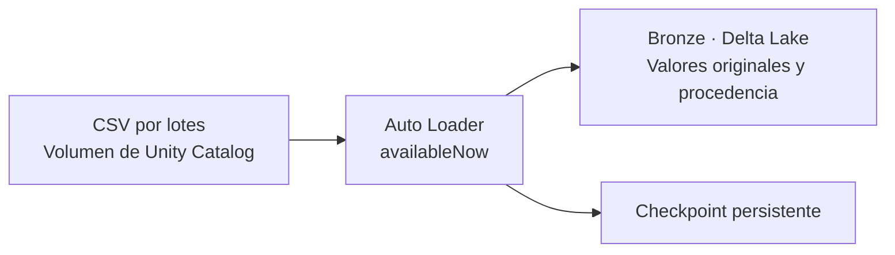

# LensData · análisis del rendimiento de vídeos

  

LensData parte de publicaciones de una tienda ficticia en TikTok e Instagram. El trabajo documentado hasta ahora prepara y carga los datos originales para analizar después su rendimiento.

El proyecto utiliza una muestra sintética de 40 publicaciones y 12 días de mediciones.

## Arquitectura

Los archivos de mediciones se conservan en `recepcion/mediciones/lote_XX/`. Bronze almacena los campos como cadenas y registra `_metadata.file_path` en `_source_file`.

## Resultados comprobados

| Comprobación | Resultado |
| --- | --- |
| Archivos recibidos | 13 CSV de los lotes 01–03, incluido `video_desconocido.csv` |
| Filas en Bronze | 471 |
| Repetición sin archivos nuevos | 471 → 471 filas |

Los resultados proceden de las ejecuciones guardadas del notebook. La carga mantiene la procedencia de cada archivo y conserva el registro del vídeo desconocido.

## Tecnologías

| Herramienta | Uso en el proyecto |
| --- | --- |
| Databricks y Unity Catalog | Volumen de recepción y tablas Bronze |
| Databricks Connect y VS Code | Desarrollo y ejecución remota de notebooks |
| PySpark y Auto Loader | Lectura recursiva e ingesta incremental de CSV |
| Delta Lake | Almacenamiento de las tablas Bronze |

## Archivos del trabajo realizado

| Ruta | Contenido |
| --- | --- |
| [`config/bronze.json`](config/bronze.json) | Rutas, tablas, checkpoints y esquemas de entrada |
| [`data/sample/`](data/sample/) | Publicaciones y lotes CSV de prueba |
| [`01_ingestar_publicaciones.ipynb`](notebooks/bronze/01_ingestar_publicaciones.ipynb) | Carga de publicaciones en Bronze |
| [`02_ingestar_mediciones.ipynb`](notebooks/bronze/02_ingestar_mediciones.ipynb) | Ingesta incremental de mediciones |
| [`scripts/generar_datos.py`](scripts/generar_datos.py) | Generación reproducible de la muestra |
| [`desarrollo.md`](desarrollo.md) | Desarrollo y evidencias de las ejecuciones |
