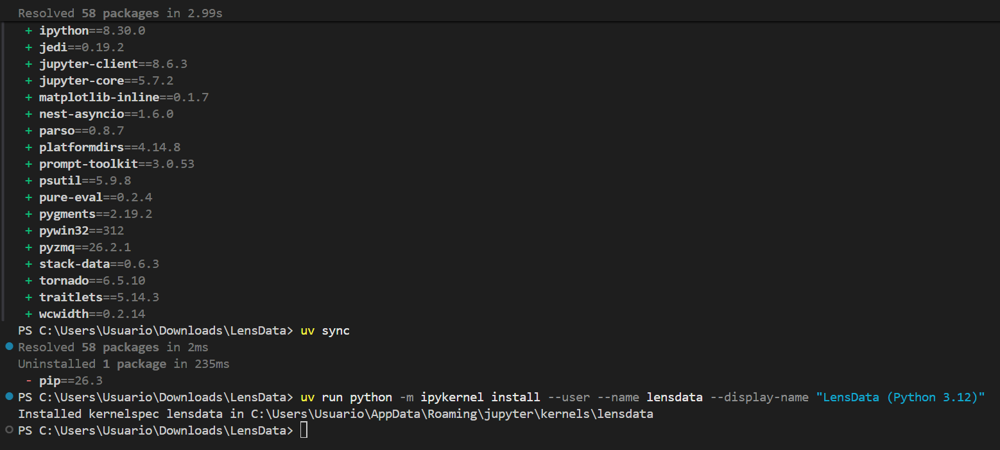
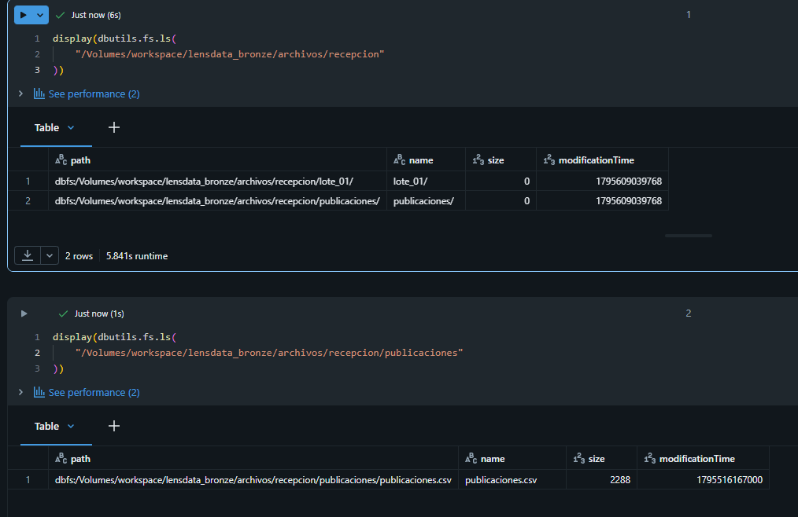
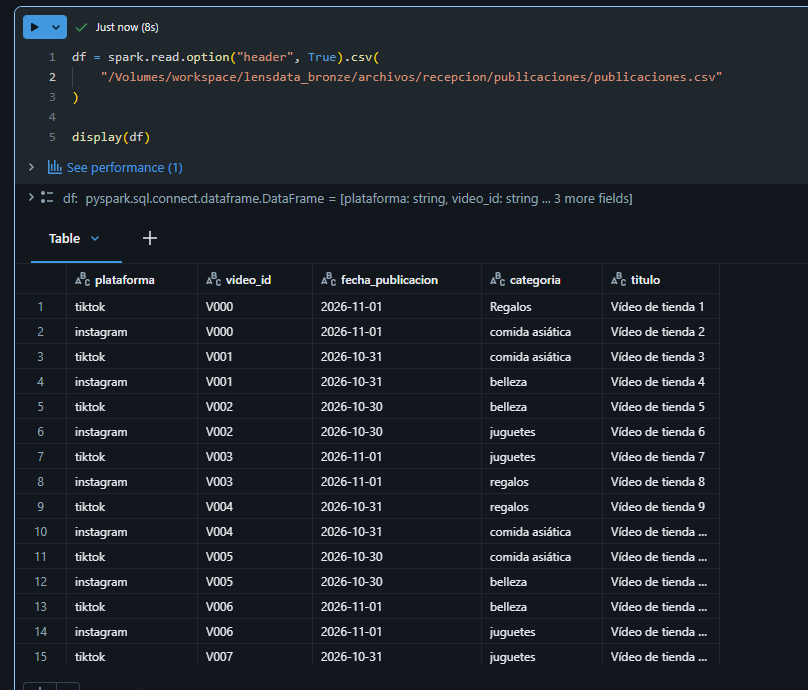
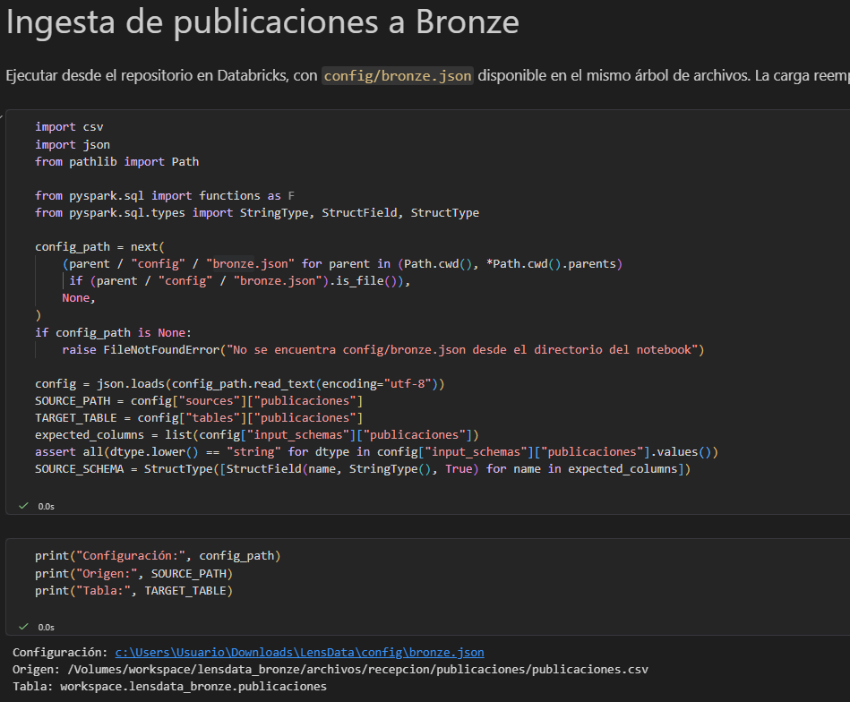
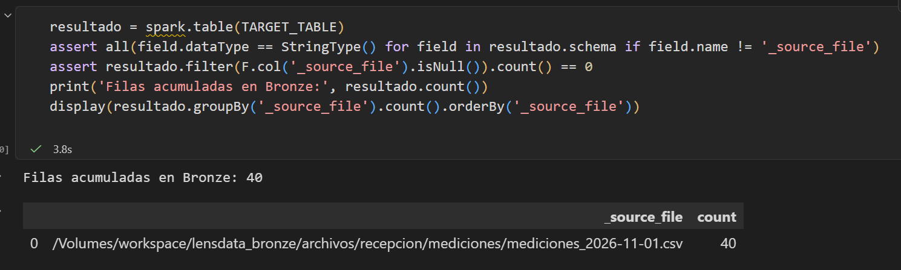
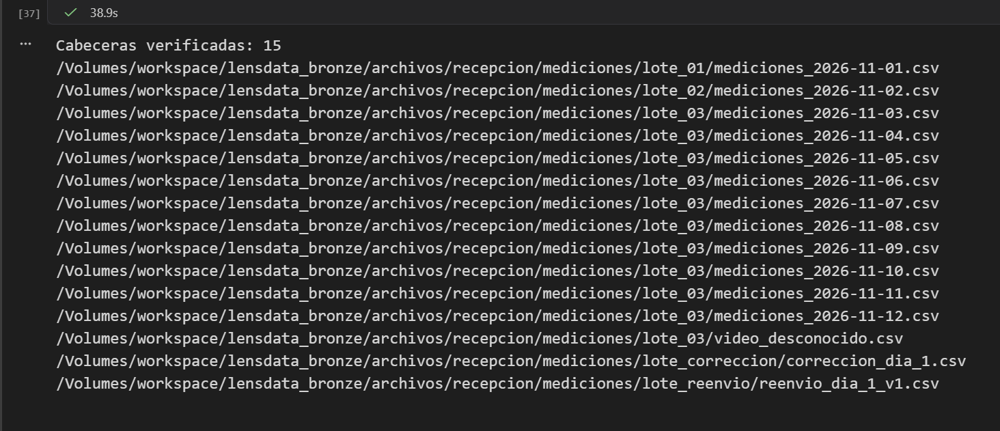
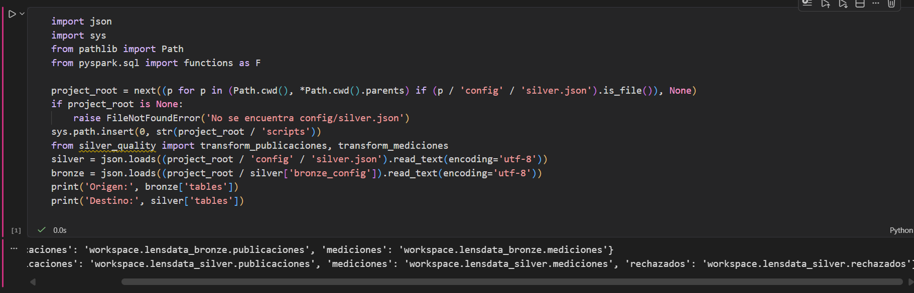
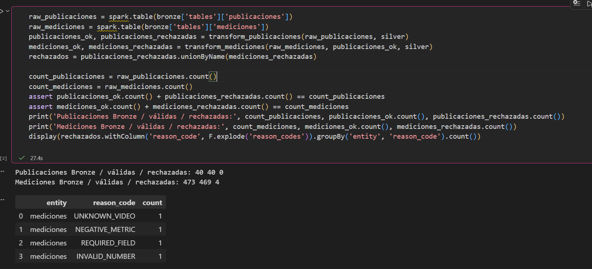
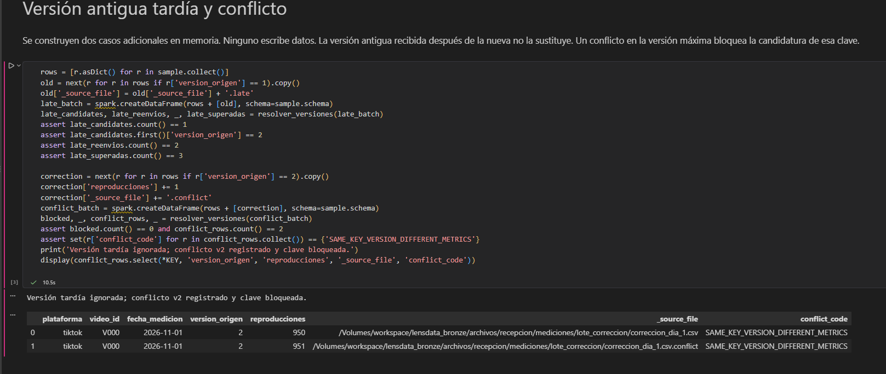

# Desarrollo · LensData

## Preparación del entorno y publicaciones

Preparé el entorno Python y el kernel local para ejecutar notebooks desde VS Code.

Comprobé el acceso al CSV de publicaciones desde el volumen. Esta captura refleja la organización inicial de recepción, anterior a la carpeta definitiva de mediciones.

Leí el CSV y revisé sus columnas y primeras filas. Esta lectura fue exploratoria; el notebook Bronze usa el esquema de cadenas de `bronze.json`.

Desde VS Code comprobé las 40 publicaciones, el valor original `Regalos ` y la procedencia. En esta ejecución, `_source_file` muestra la ruta del volumen con prefijo `dbfs:`.

## Fase 03 · Ingesta de mediciones en Bronze

> Estado observado: 15 CSV cargados en Bronze, incluidos reenvío y corrección.

### Preparación y funcionamiento

Trabajé desde VS Code con Databricks Connect para ejecutar celdas en el entorno remoto de Databricks. Esta conexión permite editar el notebook localmente y usar `spark` contra los recursos del workspace; no convierte los CSV locales en archivos del volumen. Por ello, cada lote debe copiarse al volumen `workspace.lensdata_bronze.archivos` bajo `recepcion/mediciones/<nombre_del_lote>/`.

El notebook de ingesta lee [bronze.json](config/bronze.json), recorre las subcarpetas mediante `dbutils.fs.ls` y `entry.path.endswith('/')`, y valida cada cabecera contra el esquema configurado. Auto Loader es la fuente `cloudFiles` de Structured Streaming. Lee los CSV de forma recursiva, mantiene los campos de origen como `string` y añade `_source_file` desde `_metadata.file_path`.

La validación inicial comprobó una cabecera. Tras recibir el lote 03, la búsqueda recursiva verificó 13 CSV.

El destino es una tabla Delta en modo append. El checkpoint de `config/bronze.json` guarda el progreso de la consulta para que los archivos ya procesados no se vuelvan a ingerir. `availableNow=True` procesa lo que está disponible y detiene la consulta; después se puede ejecutar de nuevo con el mismo origen y checkpoint. No se limpian checkpoints ni se sobrescriben archivos de entrada.

Comprobé en el volumen que el checkpoint de mediciones contiene `metadata`, `commits`, `offsets` y `sources`.

La primera carga dejó 40 filas. La captura conserva una ruta inicial en la raíz de `recepcion/mediciones/`; posteriormente organicé las mediciones por lotes. La carga de los lotes 01 y 02 dejó 80 filas, 40 por archivo.

Tras incorporar los archivos del lote 03, la comparación guardada mostró 471 filas. Repetí la carga sin archivos nuevos y el total siguió siendo 471.

Después incorporé `lote_reenvio` y `lote_correccion` en sus propias subcarpetas. La validación recursiva encontró 15 cabeceras correctas. Las comprobaciones de Bronze confirmaron 473 filas, 15 archivos de procedencia y la conservación separada del original, el reenvío, la corrección y `V999`.

### Pruebas observadas

Estas cifras proceden de las salidas guardadas en el notebook antes de retirar las celdas temporales; no son una nueva ejecución realizada al actualizar esta documentación.

| Comprobación | Resultado observado |
|---|---|
| Conexión Databricks Connect | Validé manualmente la conexión desde VS Code. |
| Cabeceras y descubrimiento recursivo | Salida guardada: 13 CSV verificados bajo los lotes 01, 02 y 03. |
| Conteo Bronze | Salida guardada: 471 filas = 40 + 40 + 10 × 39 + 1 de `video_desconocido.csv`. |
| Procedencia | Salida guardada: conteos por 13 rutas `_source_file`, incluidas las subcarpetas de los tres lotes. |
| Repetición sin archivos nuevos | Salida guardada: 471 antes y 471 después; incremento 0. |
| Reenvío y corrección | Captura posterior: un archivo de cada lote, 473 filas y 15 rutas en Bronze. |
| Formato Delta | La escritura usa `.format('delta')`; no consta una consulta `DESCRIBE DETAIL` en estas evidencias. |

El conteo de una fila para `video_desconocido.csv` y la comprobación posterior respaldan que Bronze conservó `V999`.

La ingesta no filtró los valores vacíos, `pendiente`, negativos, duplicados ni claves desconocidas: su tratamiento se hizo en Silver. La prueba de idempotencia capturada corresponde al estado de 471 filas, antes de recibir los dos archivos adicionales.

### `_ingested_at` y `schemaLocation`

No añadí `_ingested_at` a la tabla ya cargada. La forma conservadora de incorporarlo más adelante es parar la consulta, añadir una columna nullable `TIMESTAMP` a la tabla Delta, modificar el stream para proyectar `current_timestamp()` y reanudarlo con **el mismo** checkpoint. Los registros existentes permanecerían y tendrían `NULL` en esa columna; su hora real de ingesta no puede reconstruirse a partir de la hora de una ejecución nueva. Antes de aplicar el cambio, validar en Databricks la compatibilidad de la evolución de esquema con el runtime y hacer una prueba con un archivo nuevo. No se ha ejecutado esta migración.

Se proporciona un `StructType` explícito para los ocho campos. `cloudFiles.schemaLocation` sirve para guardar la información de inferencia y evolución de esquema; no se utiliza en este flujo de esquema fijo y el notebook ya se ejecutó sin esa opción. El checkpoint de escritura sigue siendo obligatorio y persistente. Si se decide permitir evolución de columnas de origen, habrá que definir expresamente esa política y su ubicación de esquema.

## Fases 04 y 05 · Reglas de calidad y transformación Silver

Definí los esquemas tipados y las reglas en [config/silver.json](config/silver.json). El contrato distingue errores estructurales, rechazos de calidad y advertencias; sus ejemplos y decisiones están en [tarea04_reglas_silver.md](docs/tarea04_reglas_silver.md). En [silver_quality.py](scripts/silver_quality.py) utilicé `try_cast` para fechas, versión y métricas, con separación de filas válidas y rechazadas sin modificar Bronze.

El notebook [01_transformar_silver.ipynb](notebooks/silver/01_transformar_silver.ipynb) leyó las tablas Bronze y escribió las tablas Silver de publicaciones, mediciones y rechazados en `workspace.lensdata_silver`. La captura de configuración muestra las rutas de origen y destino y la de escritura confirma la creación de las tablas derivadas.

La ejecución guardada contó 40 publicaciones Bronze: 40 válidas y 0 rechazadas. Para mediciones contó 473 Bronze: 469 válidas y 4 rechazadas. Los motivos mostrados fueron `UNKNOWN_VIDEO`, `NEGATIVE_METRIC`, `REQUIRED_FIELD` e `INVALID_NUMBER`, uno de cada uno. La suma de válidas y rechazadas coincide con Bronze en ambas entidades.

## Tarea 7 · Deduplicación y resolución de versiones

La clave de negocio de mediciones es (`plataforma`, `video_id`, `fecha_medicion`). En [deduplicar_mediciones.py](scripts/deduplicar_mediciones.py) agrupé por clave y `version_origen` para distinguir reenvíos idénticos de métricas contradictorias. Una Window Function calcula la versión máxima por clave; otra selecciona una copia representativa cuando las filas son idénticas. El orden de lectura no decide qué versión prevalece.

En la ejecución guardada de [02_resolver_versiones.ipynb](notebooks/silver/02_resolver_versiones.ipynb), las 469 mediciones válidas produjeron **467 candidatas**, **1 reenvío idéntico** y **0 filas en conflicto real**. Para `tiktok/V000/2026-11-01`, el original y el reenvío conservaron v1 con 1000 reproducciones; la candidata fue la corrección v2 con 950 y su `_source_file` de `lote_correccion`.

La última celda añadió en memoria una copia v1 tardía y otra v2 con métricas distintas. Las aserciones confirmaron que la v1 tardía no sustituyó a v2 y que el conflicto v2 dejó la clave sin candidata y registró ambas filas con `SAME_KEY_VERSION_DIFFERENT_METRICS`. Este conflicto fue **simulado**; no apareció en las 469 filas Silver reales ni se escribió en ninguna tabla.

`dropDuplicates` por clave no bastaría: podría conservar v1 y descartar v2 según la fila encontrada. La regla compara las métricas de cada versión y ordena explícitamente por `version_origen`. La salida de esta tarea permanece como DataFrame de solo lectura; no se ha ejecutado `MERGE`.

## Revisión técnica previa a la tarea 8

Detecté que el notebook Silver ejecutado reconstruía `workspace.lensdata_silver.mediciones` con `overwrite`. La conservo como tabla **intermedia de mediciones válidas** y reservé `workspace.lensdata_silver.mediciones_vigentes` como destino distinto para una futura actualización incremental. Ninguna de las comprobaciones de esta revisión creó o modificó esa tabla definitiva.

También detecté que una advertencia de clave duplicada no impedía aceptar dos publicaciones con la misma clave y que `min(fecha_publicacion)` podía ocultar un conflicto. En [silver_quality.py](scripts/silver_quality.py) eliminé ese mínimo: las copias idénticas quedan fuera del conjunto válido y se registran con `IDENTICAL_PUBLICATION_COPY`; si el contenido difiere, ambas filas se rechazan con `CONFLICTING_PUBLICATION`. Una medición que referencia esa clave recibe `AMBIGUOUS_PUBLICATION`, en vez de una fecha elegida arbitrariamente.

El [notebook Silver validado](notebooks/silver/03_transformar_silver_validado.ipynb) aplica el contrato actualizado sin escribir en `mediciones_vigentes`. El [notebook de prueba](notebooks/silver/04_validar_publicaciones_unicas.ipynb) prepara en memoria una copia idéntica, un conflicto de fecha y una medición de referencia ambigua. **Aún no se han ejecutado** estos dos notebooks en Databricks; las salidas y capturas anteriores corresponden a la ejecución previa, en la que los 40 CSV de publicaciones tenían 40 claves distintas. No modifiqué sus notebooks ejecutados ni sus resultados guardados.
