# Desarrollo - LensData

## Preparación del entorno y publicaciones

Preparamos el entorno Python y el kernel local para ejecutar notebooks desde VS Code.


Se comprueba el acceso al CSV de publicaciones desde el volumen. Esta captura refleja la organización inicial de recepción, anterior a la carpeta definitiva de mediciones, decisión tomando posteriormente para mejor visualización de la arquitectura.


La primera lectura del CSV nos permite familiarizarnos con las columnas y los datos que vamos a procesar; el notebook Bronze usa el esquema de cadenas de `bronze.json`.


Desde VS Code se comprueban las 40 publicaciones, el valor original `Regalos ` y la procedencia. En esta ejecución, `_source_file` muestra la ruta del volumen con prefijo `dbfs:`.

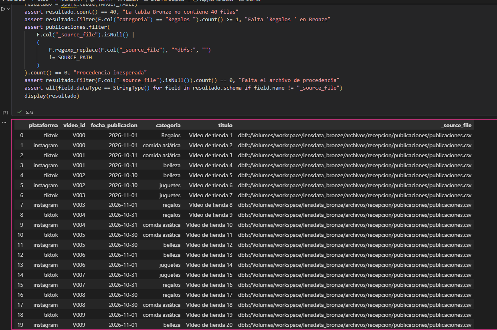

## Fase 03 - Ingesta de mediciones en Bronze

> Estado observado: 15 CSV cargados en Bronze, incluidos reenvío y corrección.

### Preparación y funcionamiento

Utilizamos Databricks Connect desde VS Code para ejecutar celdas en el entorno remoto de Databricks. Esta conexión permite editar el notebook localmente y usar `spark` contra los recursos del workspace; no convierte los CSV locales en archivos del volumen. Por ello, cada lote debe copiarse al volumen `workspace.lensdata_bronze.archivos` bajo `recepcion/mediciones/<nombre_del_lote>/` desde la interfaz de Databricks.


El notebook de ingesta lee [bronze.json](config/bronze.json), recorre las subcarpetas mediante `dbutils.fs.ls` y `entry.path.endswith('/')`, y valida cada cabecera contra el esquema configurado. Auto Loader es la fuente `cloudFiles` de Structured Streaming. Lee los CSV de forma recursiva, mantiene los campos de origen como `string` y añade `_source_file` desde `_metadata.file_path`.

La validación inicial comprobó una cabecera. Tras recibir el lote 03, la búsqueda recursiva verificó 13 CSV.

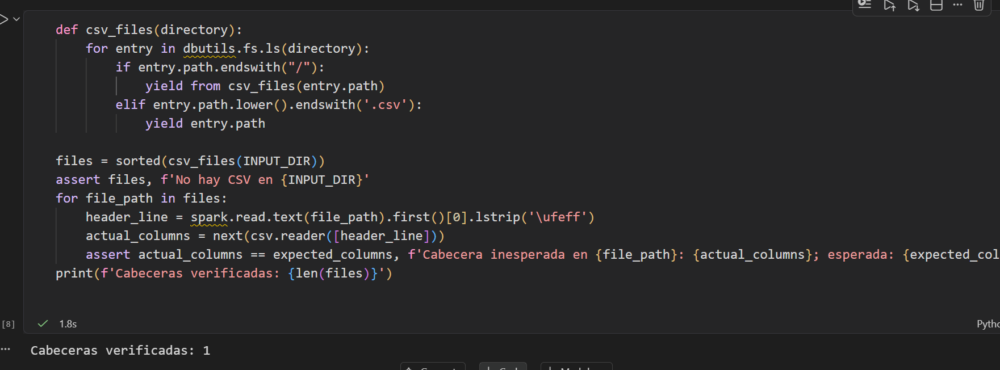


El destino es una tabla Delta en modo append. El checkpoint de `config/bronze.json` guarda el progreso de la consulta para que los archivos ya procesados no se vuelvan a ingerir. `availableNow=True` procesa lo que está disponible y detiene la consulta; después se puede ejecutar de nuevo con el mismo origen y checkpoint. No se limpian checkpoints ni se sobrescriben archivos de entrada.

En el volumen se comprueba que el checkpoint de mediciones contiene `metadata`, `commits`, `offsets` y `sources`.

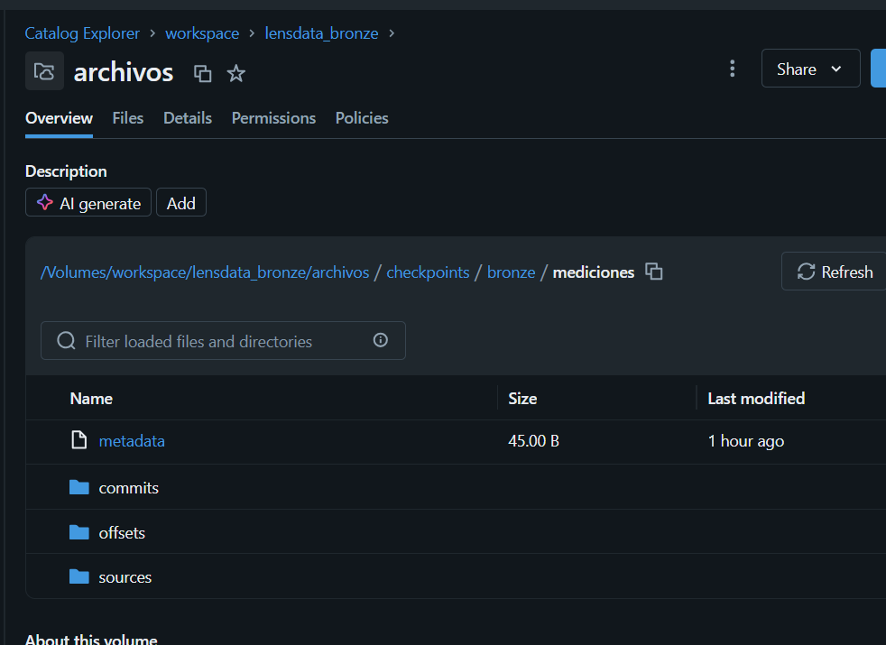

La primera carga dejó 40 filas. La captura conserva una ruta inicial en la raíz de `recepcion/mediciones/`; después organizamos las mediciones por lotes. La carga de los lotes 01 y 02 dejó 80 filas, 40 por archivo.


Tras incorporar los archivos del lote 03, la comparación guardada mostró 471 filas. Al repetir la carga sin archivos nuevos, el total sigue siendo 471.

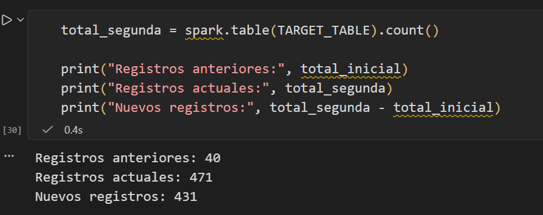

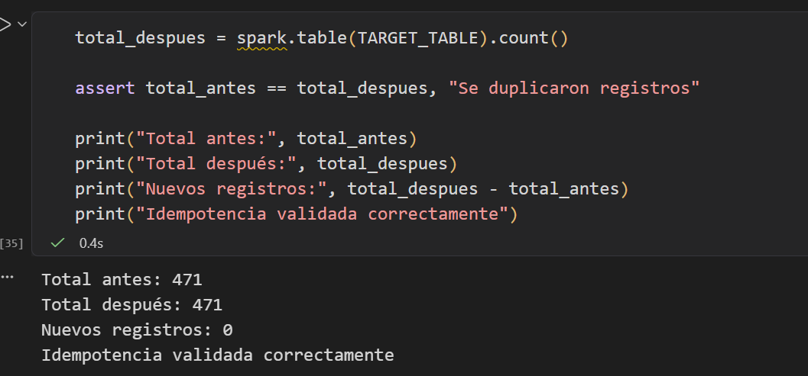

Después incorporamos `lote_reenvio` y `lote_correccion` en sus propias subcarpetas. La validación recursiva encontró 15 cabeceras correctas. Las comprobaciones de Bronze confirmaron 473 filas, 15 archivos de procedencia y la conservación separada del original, el reenvío, la corrección y `V999`.


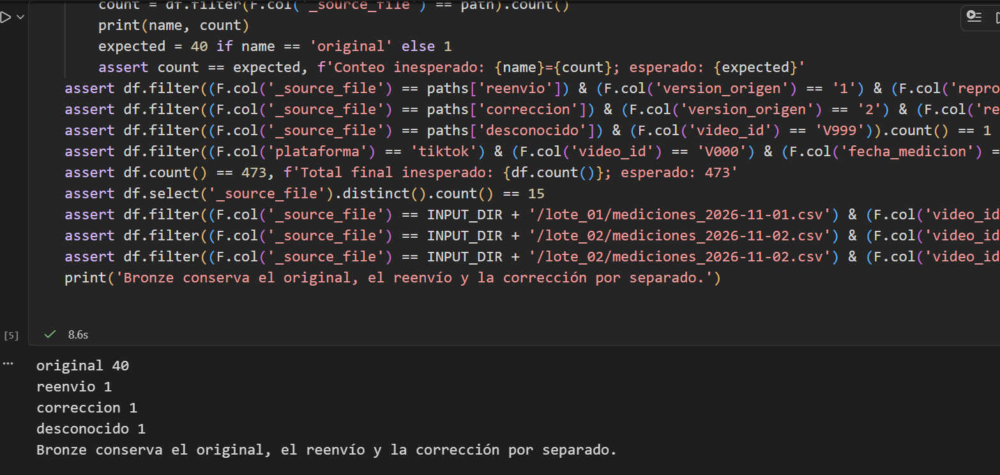

### Pruebas observadas

Estas cifras proceden de las salidas guardadas en el notebook antes de retirar las celdas temporales; no son una nueva ejecución realizada al actualizar esta documentación.

| Comprobación | Resultado observado |
|---|---|
| Conexión Databricks Connect | Conexión validada desde VS Code. |
| Cabeceras y descubrimiento recursivo | Salida guardada: 13 CSV verificados bajo los lotes 01, 02 y 03. |
| Conteo Bronze | Salida guardada: 471 filas = 40 + 40 + 10 × 39 + 1 de `video_desconocido.csv`. |
| Procedencia | Salida guardada: conteos por 13 rutas `_source_file`, incluidas las subcarpetas de los tres lotes. |
| Repetición sin archivos nuevos | Salida guardada: 471 antes y 471 después; incremento 0. |
| Reenvío y corrección | Captura posterior: un archivo de cada lote, 473 filas y 15 rutas en Bronze. |
| Formato Delta | La escritura usa `.format('delta')`; no consta una consulta `DESCRIBE DETAIL` en estas evidencias. |

El conteo de una fila para `video_desconocido.csv` y la comprobación posterior respaldan que Bronze conservó `V999`.

La ingesta no filtró los valores vacíos, `pendiente`, negativos, duplicados ni claves desconocidas: su tratamiento se hizo en Silver. La prueba de idempotencia capturada corresponde al estado de 471 filas, antes de recibir los dos archivos adicionales.

### Esquema y checkpoint

La ingesta utiliza un `StructType` explícito para los ocho campos, conserva `_source_file` y mantiene el checkpoint persistente de escritura. El esquema fijo permite ejecutar Auto Loader sin `cloudFiles.schemaLocation`.

## Fases 04 y 05 - Reglas de calidad y transformación Silver

Definimos los tipos de datos y las reglas en [config/silver.json](config/silver.json). El contrato distingue errores estructurales, rechazos de calidad y advertencias; sus ejemplos y decisiones están en [contrato de calidad](docs/calidad_datos.md). En [silver_quality.py](scripts/silver_quality.py) se utiliza `try_cast` para convertir fechas, versión y métricas. Se separan las filas válidas de las rechazadas sin modificar Bronze.

El notebook [01_transformar_silver.ipynb](docs/historico/01_transformar_silver.ipynb) leyó las tablas Bronze y escribió las tablas Silver de publicaciones, mediciones y rechazados en `workspace.lensdata_silver`. La captura de configuración muestra las rutas de origen y destino y la de escritura confirma la creación de las tablas derivadas.


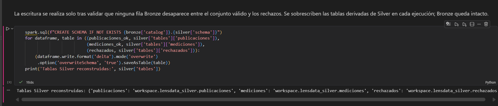

La ejecución guardada contó 40 publicaciones Bronze: 40 válidas y 0 rechazadas. Para mediciones contó 473 Bronze: 469 válidas y 4 rechazadas. Los motivos mostrados fueron `UNKNOWN_VIDEO`, `NEGATIVE_METRIC`, `REQUIRED_FIELD` e `INVALID_NUMBER`, uno de cada uno. La suma de válidas y rechazadas coincide con Bronze en ambas entidades.


## Tarea 7 - Deduplicación y resolución de versiones

La clave de negocio de mediciones es (`plataforma`, `video_id`, `fecha_medicion`). En [deduplicar_mediciones.py](scripts/deduplicar_mediciones.py) agrupamos por clave y `version_origen` para distinguir reenvíos idénticos de métricas contradictorias. Una Window Function calcula la versión máxima por clave; otra selecciona una copia representativa cuando las filas son idénticas. El orden de lectura no decide qué versión prevalece.

En la ejecución guardada de [test_versiones.ipynb](tests/test_versiones.ipynb), las 469 mediciones válidas produjeron **467 candidatas**, **1 reenvío idéntico** y **0 filas en conflicto real**. Para `tiktok/V000/2026-11-01`, el original y el reenvío conservaron v1 con 1000 reproducciones; la candidata fue la corrección v2 con 950 y su `_source_file` de `lote_correccion`.

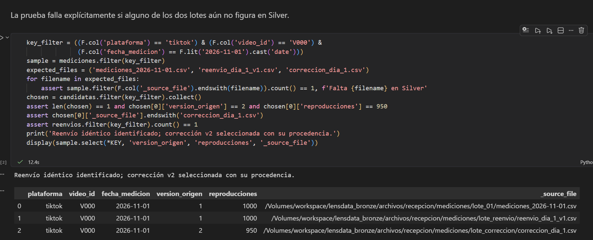

La última celda añadió en memoria una copia v1 tardía y otra v2 con métricas distintas. Las aserciones confirmaron que la v1 tardía no sustituyó a v2 y que el conflicto v2 dejó la clave sin candidata y registró ambas filas con `SAME_KEY_VERSION_DIFFERENT_METRICS`. Este conflicto fue **simulado**; no apareció en las 469 filas Silver reales ni se escribió en ninguna tabla.


`dropDuplicates` por clave no bastaría: podría conservar v1 y descartar v2 según la fila encontrada. La regla compara las métricas de cada versión y ordena explícitamente por `version_origen`. La función devuelve DataFrames de solo lectura que se utilizan como entrada de la consolidación.

## Validación de publicaciones y separación de tablas

La transformación reconstruye `workspace.lensdata_silver.mediciones` con `overwrite` como tabla intermedia de mediciones válidas. La consolidación escribe en una tabla definitiva independiente, `workspace.lensdata_silver.mediciones_vigentes`.

Durante las pruebas detectamos que una advertencia de clave duplicada no impedía aceptar dos publicaciones con la misma clave y que `min(fecha_publicacion)` podía ocultar un conflicto. En [silver_quality.py](scripts/silver_quality.py) se elimina ese mínimo: las copias idénticas quedan fuera del conjunto válido y se registran con `IDENTICAL_PUBLICATION_COPY`; si el contenido difiere, ambas filas se rechazan con `CONFLICTING_PUBLICATION`. Una medición que referencia esa clave recibe `AMBIGUOUS_PUBLICATION`, en vez de una fecha elegida arbitrariamente.

El [notebook Silver validado](notebooks/silver/01_transformar_silver.ipynb) aplica el contrato actualizado sin escribir en `mediciones_vigentes`. El [notebook de prueba](tests/test_silver_quality.ipynb) prepara en memoria una copia idéntica, un conflicto de fecha y una medición de referencia ambigua. Las salidas guardadas de la transformación validada muestran 40 publicaciones válidas, 469 mediciones válidas y 4 rechazadas; la prueba de publicaciones únicas confirma los tres casos simulados. La reorganización conserva esas salidas y no implica una nueva ejecución.

## Reorganización del repositorio

Los notebooks operativos quedan en `notebooks/` y las comprobaciones manuales en `tests/`. La primera transformación Silver se conserva como evidencia histórica en `docs/historico/`, no como notebook ejecutable. Las imágenes, configuraciones, tablas y checkpoints no cambian.

## Tarea 8 - Consolidación incremental con Delta MERGE

La consolidación se realiza mediante [merge_mediciones.py](scripts/merge_mediciones.py) y el [notebook de consolidación](notebooks/silver/02_merge_mediciones.ipynb). Antes de escribir, se comprueba por archivo que el número de filas Bronze coincide con la suma de filas válidas y rechazadas. El registro `archivos_procesados` selecciona las rutas sin confirmar; la función de resolución de versiones entrega una candidata única por clave.

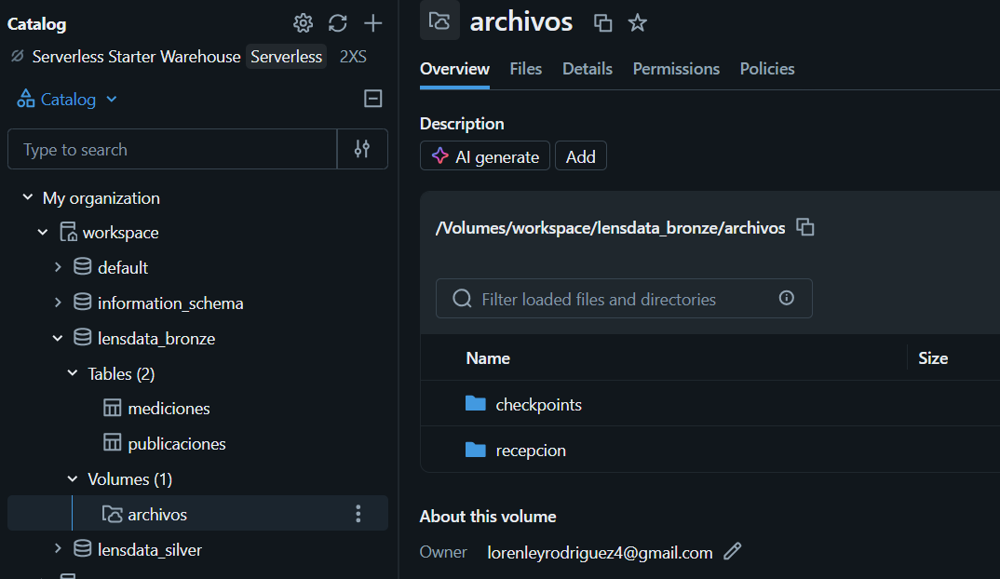

| Tabla Silver | Responsabilidad |
|---|---|
| `mediciones_vigentes` | Una medición vigente por plataforma, vídeo y fecha |
| `conflictos_version` | Conflictos de métricas para una misma clave y versión |
| `archivos_procesados` | Rutas confirmadas y recuentos de filas Bronze |

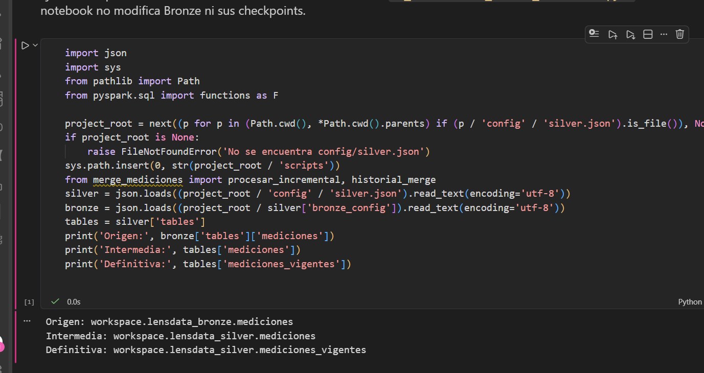

El MERGE inserta claves nuevas y actualiza las existentes únicamente cuando la versión de origen es superior a la vigente. Las versiones iguales o inferiores no sustituyen el destino. Los conflictos se registran con un identificador determinista y los archivos se confirman después de escribir el destino. Bronze y su checkpoint permanecen intactos.

La creación inicial de tablas se realiza con `CREATE TABLE IF NOT EXISTS ... USING DELTA`, que sustituyó el modo `errorifexists` incompatible con la ejecución mediante Databricks Connect.

### Ejecución y resultados

| Indicador | Resultado observado |
|---|---:|
| Archivos procesados | 15 |
| Candidatas | 467 |
| Reenvíos idénticos en el lote | 1 |
| Filas de versiones superadas | 2 |
| Conflictos dentro del lote | 0 |
| Conflictos con el destino | 0 |

Las categorías de reenvío y versión superada pueden solaparse. El notebook verificó la unicidad de la clave, la procedencia no nula y las versiones positivas, y consultó el historial Delta.


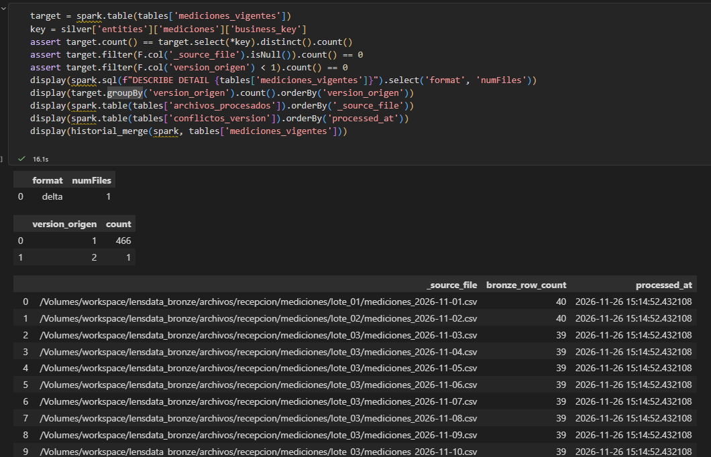

### Pruebas de integración

En [test_merge.ipynb](tests/test_merge.ipynb) utilizamos tablas Delta independientes y datos simulados para comprobar los siguientes comportamientos:

| Escenario | Resultado |
|---|---|
| Inserción | Una fila nueva, versión 1 |
| Reenvío idéntico | Conserva la fila original |
| Corrección | Actualiza a versión 2, con 90 reproducciones |
| Versión antigua tardía | Conserva versión 2 |
| Conflicto con el destino | Registra el conflicto y conserva 90 reproducciones |
| Repetición idempotente | Conserva la corrección sin cambios |
| Conflicto dentro del lote | Registra dos filas conflictivas y conserva versión 2 |

Las pruebas incluyen aserciones de unicidad y de métricas de inserción y actualización del historial Delta cuando están disponibles. Los conflictos simulados pertenecen a las tablas de prueba, no a las mediciones reales.

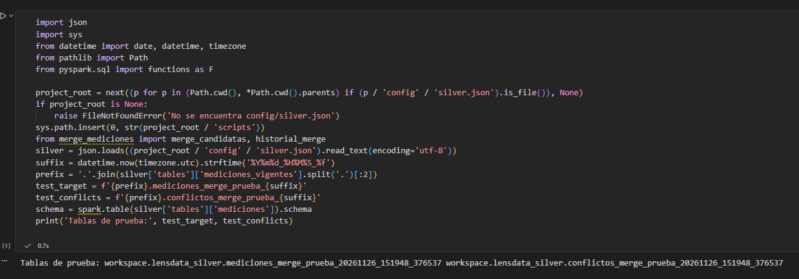

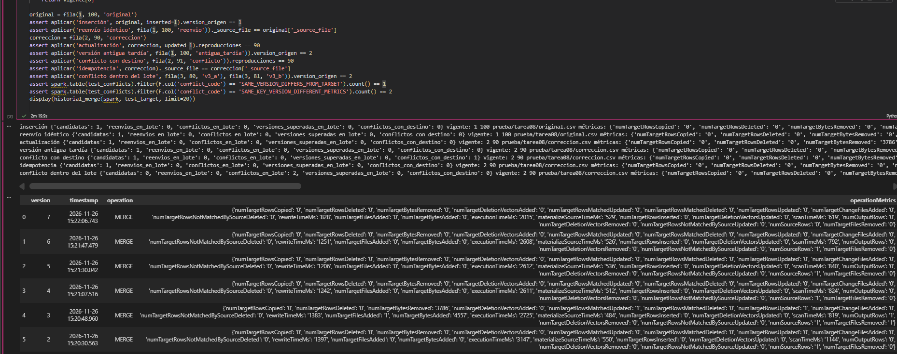


## Tarea 9 - Capa Gold

Una vez consolidadas las mediciones en Silver, utilizamos las tablas `publicaciones` y `mediciones_vigentes` para crear las tres tablas de análisis en `workspace.lensdata_gold`. La idea es comparar qué categorías funcionan mejor sin contar varias veces las mediciones de un mismo vídeo y fecha, aprovechando la ingesta incremental con Auto Loader y la consolidación de versiones con MERGE.

En [gold_metrics.py](scripts/gold_metrics.py) unimos las publicaciones y las mediciones por `plataforma` y `video_id`, ya que el identificador de un vídeo se puede repetir entre TikTok e Instagram. Se calcula el día de vida con `datediff(fecha_medicion, fecha_publicacion) + 1` y se suman los me gusta, comentarios y compartidos para obtener las interacciones totales del vídeo.

```python
F.datediff("fecha_medicion", "fecha_publicacion") + 1
```

El día de publicación cuenta como día 1. Elegimos el día 3 como punto de comparación entre categorías y plataformas, porque consideramos que es un plazo razonable para acumular interacciones. Así comparamos vídeos con la misma antigüedad. La tasa de interacción se obtiene dividiendo las interacciones entre las reproducciones y multiplicando por 100. En las agregaciones dividimos la suma de las interacciones entre la suma de las reproducciones de los vídeos con reproducciones positivas, en lugar de hacer una media de porcentajes. Si un vídeo tiene cero reproducciones, su tasa es nula.

### Creación de tablas

Ejecutamos [01_generar_gold.ipynb](notebooks/gold/01_generar_gold.ipynb) con la configuración de [gold.json](config/gold.json). Las tablas se escriben en formato Delta con `overwrite`, ya que son resultados derivados que se recalculan a partir de Silver vigente.

| Tabla | Granularidad | Filas |
|---|---|---:|
| `rendimiento_video` | Plataforma, vídeo y fecha de medición | 467 |
| `rendimiento_categoria` | Plataforma y categoría al día 3 | 8 |
| `rendimiento_plataforma` | Plataforma al día 3 | 2 |

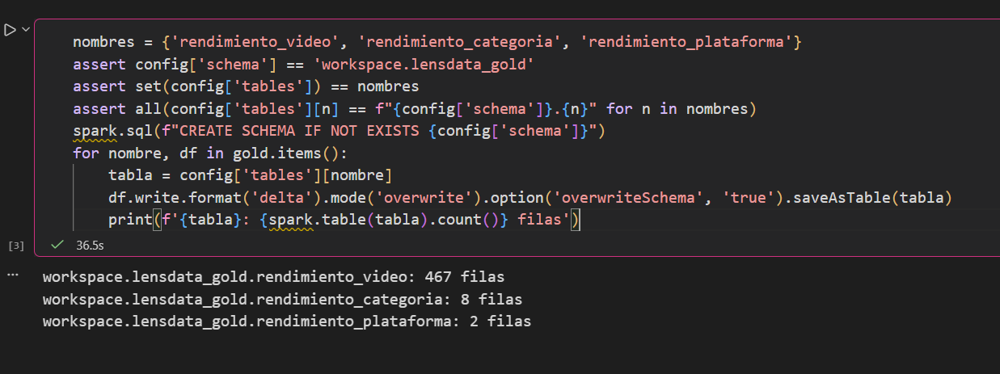

En la tabla por vídeo se comprueba que TikTok V000 conserva la corrección v2 de Silver: 950 reproducciones y 70 interacciones el primer día. El segundo día registra 1200 reproducciones y 90 interacciones.

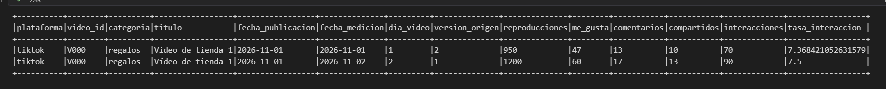

### Comparación de categorías y plataformas

| Plataforma | Categoría | Vídeos medidos | Cobertura | Tasa de interacción |
|---|---|---:|---:|---:|
| Instagram | Comida asiática | 5/5 | 100 % | 7,00 % |
| Instagram | Juguetes | 5/5 | 100 % | 6,70 % |
| Instagram | Belleza | 5/5 | 100 % | 6,70 % |
| Instagram | Regalos | 5/5 | 100 % | 6,32 % |
| TikTok | Comida asiática | 4/5 | 80 % | 7,02 % |
| TikTok | Belleza | 5/5 | 100 % | 6,70 % |
| TikTok | Juguetes | 5/5 | 100 % | 6,64 % |
| TikTok | Regalos | 4/5 | 80 % | 6,59 % |


Comida asiática obtuvo la mayor tasa de interacción en las dos redes dentro de la muestra. Sin embargo, TikTok tiene dos vídeos sin medición del tercer día, uno de regalos y otro de comida asiática. Por eso incluimos el tamaño de muestra y la cobertura: además del porcentaje de interacción, interesa saber cuántas publicaciones se han podido medir.

| Plataforma | Vídeos medidos | Reproducciones | Interacciones | Tasa | Cobertura |
|---|---:|---:|---:|---:|---:|
| Instagram | 20/20 | 3612 | 243 | 6,73 % | 100 % |
| TikTok | 18/20 | 3607 | 243 | 6,74 % | 90 % |

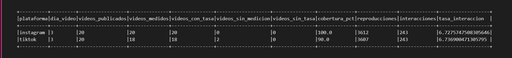

Estos resultados corresponden a los datos sintéticos que generamos y cargamos desde los CSV.

### Pruebas de Gold

En [test_gold.ipynb](tests/test_gold.ipynb) utilizamos datos controlados en memoria para comprobar el cálculo del día 3, la cobertura, la tasa ponderada (25 interacciones y 400 reproducciones = 6,25 %), los vídeos con cero reproducciones y los grupos sin mediciones. También se comprueba que las claves duplicadas de publicaciones y mediciones provocan un error.

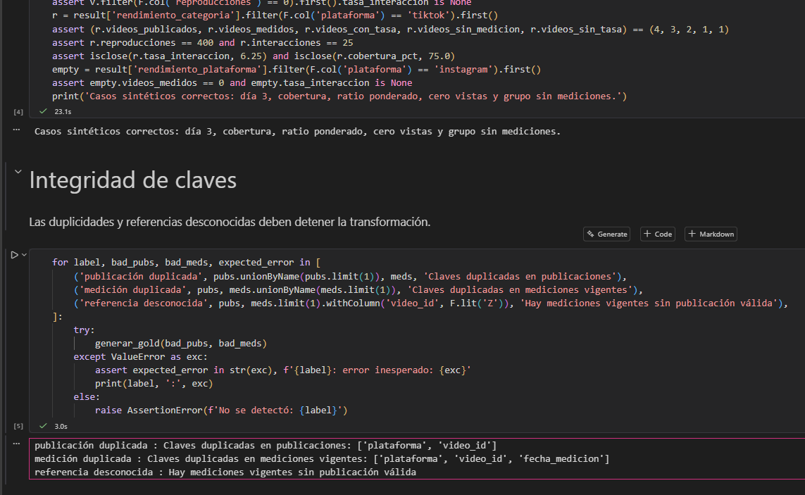

Después leemos las tablas originales de Silver y las tablas Gold almacenadas. Se utiliza `exceptAll` en ambos sentidos para comprobar que no haya filas diferentes entre Gold y su reconstrucción desde Silver. También se comprueban las claves únicas y los conteos de cobertura. La reconciliación devolvió 467, 8 y 2 filas respectivamente, sin diferencias.

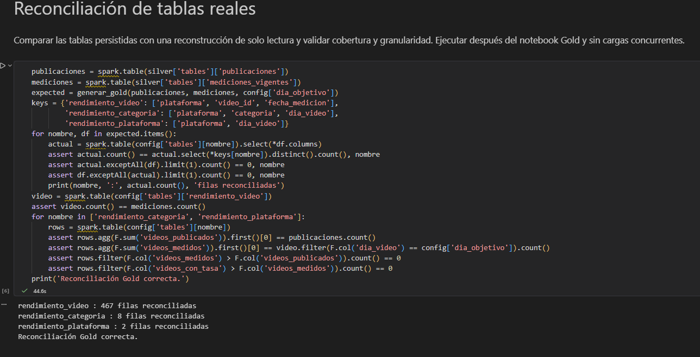

Posteriormente, calculamos los indicadores directamente desde Silver mediante consultas SQL y los comparamos con los resultados de Gold generados mediante PySpark, demostrando que coinciden a la perfección.

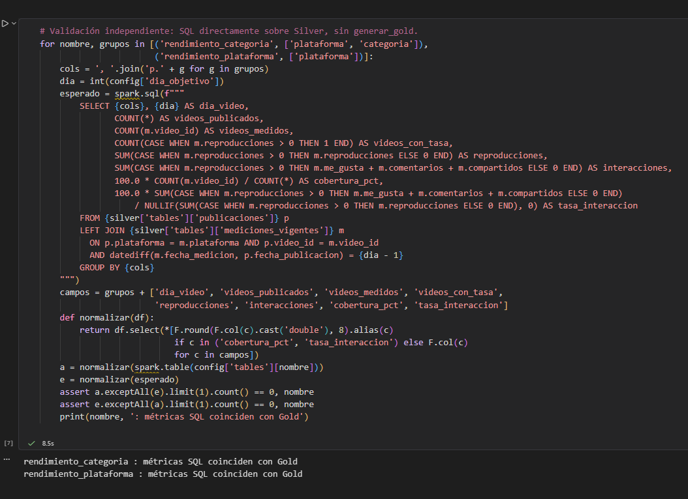

## Tarea 10 - Lakeflow 

### Preparación de entorno
Hasta ahora, se ejecutaba cada notebook con el ordenador manualmente buscando los archivos de configuración mediante Path.cwd(). Ahora nuestra idea es desplegar la transformación en un entorno laboral, que encuentre de por si Databricks los scripts y configuraciones dentro del workspace remoto. El script `preparar_lakeflow.py" hace justamente eso, adapta los notebooks de las capas para recibir la ruta del proyecto com un parámetro, por lo que también se pueden ejecutar desde VS Code aún.
No modifica la lógica de transformación ni las tablas.

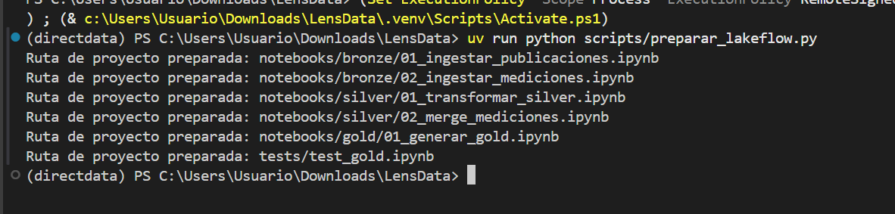

Modificación de los notebooks en `resources/lensdata_job.yml`

```yaml
- task_key: silver_transformar

  depends_on:
    - task_key: bronze_mediciones

  notebook_task:
    notebook_path: ../notebooks/silver/01_transformar_silver.ipynb
    base_parameters:
      project_root: ${workspace.file_path}
```

## Activar y desplegar bundle 

A continuación validamos el bundle ejecutando

```bash
databricks auth profiles
databricks bundle validate -t dev
``` 

Y como era de esperado, recibimos un `Validation OK!`

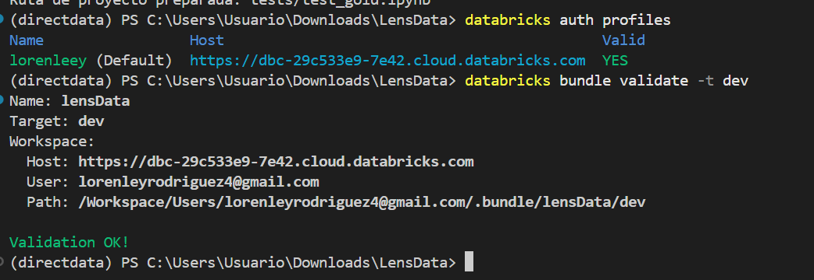

Una vez validado, se despegó el budle, esto crea o actualiza el job y sincroniza los archivos necesarios del proyecto. Todavía no ejecuta el pipeline.

``` bash
databricks bundle deploy -t dev
``` 

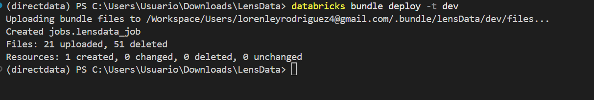

### Run lakeflow

Al entrar en la interfaz online de databricks se visualiza el lakeflow creado

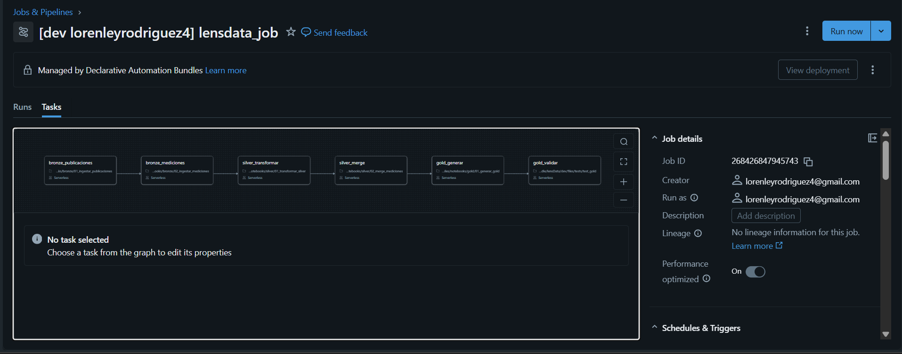

Al darle al botón de arriba a la derecha `Run now`, se empiezan a ejecutar nuestro flujo de Jobs. Luego de 4 minutos finalizó y podemos visualizar cuanto duró en cada notebook, y que fue ejecutado con estado `Succeeded`.

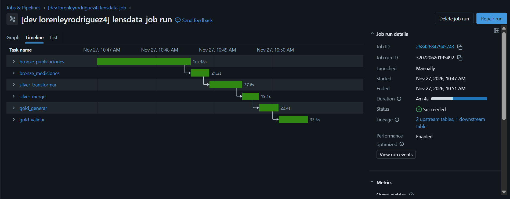


