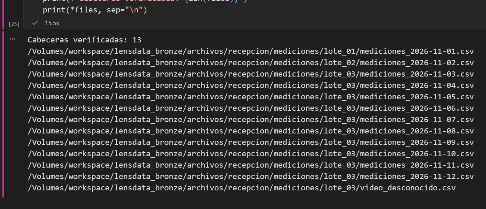
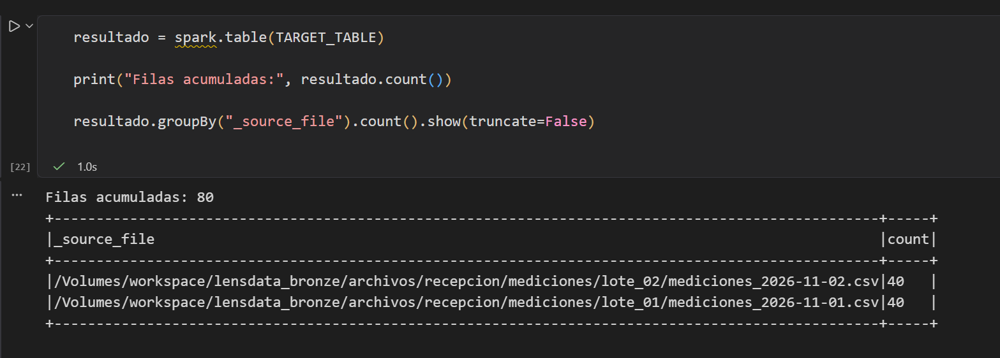
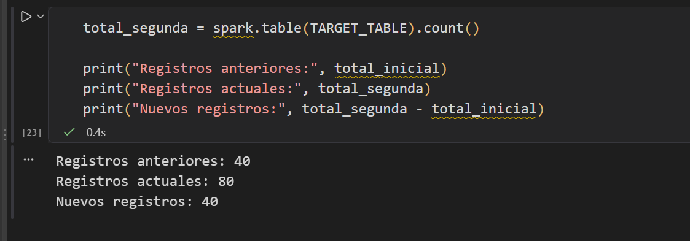

# Desarrollo · LensData

## Preparación del entorno y publicaciones

Preparé el entorno Python y el kernel local para ejecutar notebooks desde VS Code.

Comprobé el acceso al CSV de publicaciones desde el volumen. Esta captura refleja la organización inicial de recepción, anterior a la carpeta definitiva de mediciones.

Leí el CSV y revisé sus columnas y primeras filas. Esta lectura fue exploratoria; el notebook Bronze usa el esquema de cadenas de `bronze.json`.

Desde VS Code comprobé las 40 publicaciones, el valor original `Regalos ` y la procedencia. En esta ejecución, `_source_file` muestra la ruta del volumen con prefijo `dbfs:`.

## Fase 03 · Ingesta de mediciones en Bronze

> Estado: ingesta de lotes 01–03 comprobada manualmente; cierre pendiente de reenvío, corrección, validaciones finales y capturas.

### Preparación y funcionamiento

Trabajé desde VS Code con Databricks Connect para ejecutar celdas en el entorno remoto de Databricks. Esta conexión permite editar el notebook localmente y usar `spark` contra los recursos del workspace; no convierte los CSV locales en archivos del volumen. Por ello, cada lote debe copiarse al volumen `workspace.lensdata_bronze.archivos` bajo `recepcion/mediciones/<nombre_del_lote>/`.

El notebook de ingesta lee [bronze.json](config/bronze.json), recorre las subcarpetas mediante `dbutils.fs.ls` y `entry.path.endswith('/')`, y valida cada cabecera contra el esquema configurado. Auto Loader es la fuente `cloudFiles` de Structured Streaming. Lee los CSV de forma recursiva, mantiene los campos de origen como `string` y añade `_source_file` desde `_metadata.file_path`.

La validación inicial comprobó una cabecera. Tras recibir el lote 03, la búsqueda recursiva verificó 13 CSV.

El destino es una tabla Delta en modo append. El checkpoint de `config/bronze.json` guarda el progreso de la consulta para que los archivos ya procesados no se vuelvan a ingerir. `availableNow=True` procesa lo que está disponible y detiene la consulta; después se puede ejecutar de nuevo con el mismo origen y checkpoint. No se limpian checkpoints ni se sobrescriben archivos de entrada.

La primera carga dejó 40 filas. La captura conserva una ruta inicial en la raíz de `recepcion/mediciones/`; posteriormente organicé las mediciones por lotes. La carga de los lotes 01 y 02 dejó 80 filas, 40 por archivo.

Tras incorporar los archivos del lote 03, la comparación guardada mostró 471 filas. Repetí la carga sin archivos nuevos y el total siguió siendo 471.

### Pruebas observadas

Estas cifras proceden de las salidas guardadas en el notebook antes de retirar las celdas temporales; no son una nueva ejecución realizada al actualizar esta documentación.

| Comprobación | Resultado observado |
|---|---|
| Conexión Databricks Connect | Validé manualmente la conexión desde VS Code. |
| Cabeceras y descubrimiento recursivo | Salida guardada: 13 CSV verificados bajo los lotes 01, 02 y 03. |
| Conteo Bronze | Salida guardada: 471 filas = 40 + 40 + 10 × 39 + 1 de `video_desconocido.csv`. |
| Procedencia | Salida guardada: conteos por 13 rutas `_source_file`, incluidas las subcarpetas de los tres lotes. |
| Repetición sin archivos nuevos | Salida guardada: 471 antes y 471 después; incremento 0. |
| Reenvío y corrección | Pendientes; no aparecían entre los 13 CSV listados. |
| Formato Delta | Configurado en la escritura; consulta `DESCRIBE DETAIL` aún pendiente. |

El conteo de una fila para `video_desconocido.csv` respalda que Bronze recibió un registro potencialmente inválido. Queda comprobar sus valores directamente en la tabla con el notebook de validación.

### Cierre de reenvío y corrección

1. Copiar `data/sample/lote_reenvio/reenvio_dia_1_v1.csv` a `recepcion/mediciones/lote_reenvio/` y `data/sample/lote_correccion/correccion_dia_1.csv` a `recepcion/mediciones/lote_correccion/`. Mantener ambos nombres y no modificar los CSV ya cargados.
2. Ejecutar `02_ingestar_mediciones.ipynb`. El resultado **esperado, aún no observado**, es 473 filas: 471 + 1 + 1.
3. Ejecutar `03_validar_mediciones_bronze.ipynb`, incluida su última celda. Debe mostrar el original, el reenvío y la corrección de `tiktok/V000/2026-11-01` como tres filas distintas; dos tienen `version_origen=1` y una `version_origen=2`. Debe conservar también `V999`.
4. Repetir la ingesta sin añadir archivos y volver a ejecutar la validación. El total esperado sigue siendo 473. Guardar los conteos de antes y después como evidencia de idempotencia.

Las comprobaciones de esquema, rutas, valores, duplicados y Delta están en el notebook de validación. La ingesta no filtra los valores vacíos, `pendiente`, negativos, duplicados ni claves desconocidas: su tratamiento corresponde a Silver.

### `_ingested_at` y `schemaLocation`

No añadí `_ingested_at` a la tabla ya cargada. La forma conservadora de incorporarlo más adelante es parar la consulta, añadir una columna nullable `TIMESTAMP` a la tabla Delta, modificar el stream para proyectar `current_timestamp()` y reanudarlo con **el mismo** checkpoint. Los registros existentes permanecerían y tendrían `NULL` en esa columna; su hora real de ingesta no puede reconstruirse a partir de la hora de una ejecución nueva. Antes de aplicar el cambio, validar en Databricks la compatibilidad de la evolución de esquema con el runtime y hacer una prueba con un archivo nuevo. No se ha ejecutado esta migración.

Se proporciona un `StructType` explícito para los ocho campos. `cloudFiles.schemaLocation` sirve para guardar la información de inferencia y evolución de esquema; no se utiliza en este flujo de esquema fijo y el notebook ya se ejecutó sin esa opción. El checkpoint de escritura sigue siendo obligatorio y persistente. Si se decide permitir evolución de columnas de origen, habrá que definir expresamente esa política y su ubicación de esquema.
